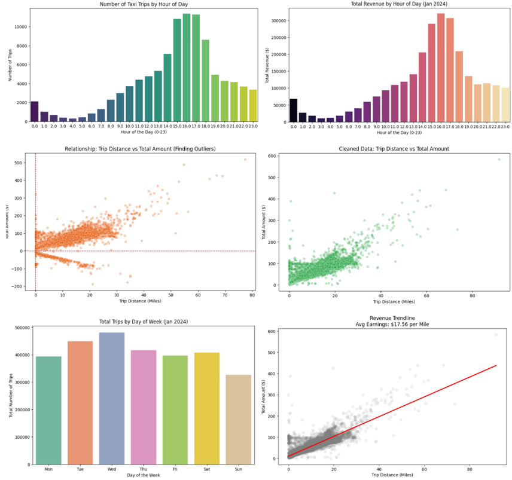

# โปรเจกต์วิเคราะห์ข้อมูลแท็กซี่นิวยอร์ก (NYC Yellow Taxi Data Analysis)

โปรเจกต์นี้เป็นการนำข้อมูลการเดินทางของแท็กซี่ในนิวยอร์ก (เดือนมกราคม 2024) มาวิเคราะห์เพื่อหาพฤติกรรมการเรียกใช้งานของผู้โดยสาร และสร้าง AI (Machine Learning) เบื้องต้นเพื่อพยากรณ์ราคาค่าโดยสารครับ

---

## 🗄️ โครงสร้างข้อมูล (Data Dictionary)

เพื่อให้เข้าใจง่าย ข้อมูลในโปรเจกต์นี้แบ่งออกเป็น 2 ส่วนหลักๆ

### 1. ข้อมูลดิบจากฐานข้อมูล (Raw Data)
เป็นข้อมูลมาตรฐานที่เราดึงมาจาก Database:
 `tpep_pickup_datetime`: วันและเวลาที่ลูกค้าขึ้นรถ
 `tpep_dropoff_datetime`: วันและเวลาที่ลูกค้าลงรถ
 `trip_distance`: ระยะทางที่วิ่งจริง (ไมล์)
 `total_amount`: ค่าโดยสารรวมที่ลูกค้าจ่ายจริง ($)
 `fare_amount`: ค่าโดยสารตามมิเตอร์
 `tip_amount`: ทิปที่จ่ายผ่านบัตรเครดิต
 `passenger_count`: จำนวนผู้โดยสารในรถ

### 2. ข้อมูลที่สร้างขึ้นมาใหม่เพื่อใช้วิเคราะห์ (Engineered Features)
เราได้เขียนโค้ดสกัดข้อมูลเพิ่ม เพื่อให้เห็นภาพรวมของธุรกิจชัดเจนขึ้น:
 `pickup_hour`: ชั่วโมงที่ลูกค้าขึ้นรถ (0-23) ใช้สร้างกราฟดูช่วงเวลาเร่งด่วน
 `day_name`: วันในสัปดาห์ (จันทร์-อาทิตย์) ใช้ดูว่าวันไหนลูกค้านิยมเรียกแท็กซี่มากที่สุด
 `duration_minutes`: ระยะเวลาเดินทาง (นาที) ใช้สะท้อนสภาพ "รถติด" เพื่อให้ AI ทายราคาได้แม่นยำขึ้น

---

## สรุปผลลัพธ์ที่ได้
 **พฤติกรรมลูกค้า** ปริมาณการเรียกแท็กซี่จะเริ่มพุ่งสูงขึ้นในช่วงปลายสัปดาห์ (วันศุกร์ - วันอาทิตย์)
 **AI ทำนายราคา** เราค้นพบสมการทำนายราคาค่าโดยสาร โดย AI เรียนรู้ว่าค่าโดยสารไม่ได้คิดจาก "ระยะทาง" เพียงอย่างเดียว แต่จะแปรผันตาม "จำนวนนาที" ที่เสียไปบนรถด้วย (ยิ่งรถติดยิ่งแพง) รวมถึงมีค่าบริการเริ่มต้น (Base Fare) ซ่อนอยู่

## ตัวอย่างกราฟวิเคราะห์

---

## เครื่องมือที่ใช้
 **ภาษาและไลบรารี:** Python (Pandas, Numpy, Matplotlib, Seaborn, Scikit-Learn)
 **ฐานข้อมูล:** PostgreSQL (รันผ่าน Docker)
 **การพัฒนา:** Jupyter Notebook

---

